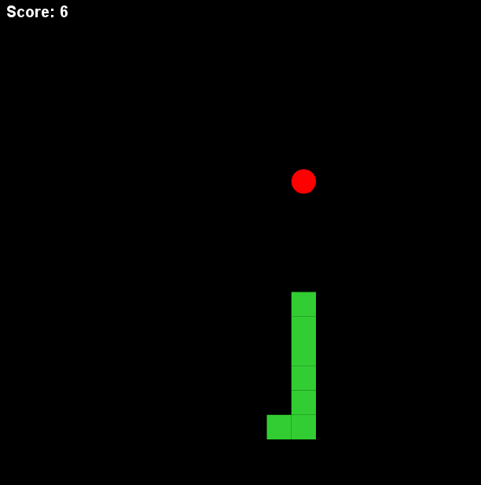

# 🐍 Java Quest – Snake Edition


A classic Snake game built with **Java 21 and Java Swing**.

This project demonstrates object-oriented programming, game logic implementation, graphical user interface development, and automated unit testing.

## 🎮 Features

- Classic Snake gameplay
- Keyboard-controlled movement
- Food generation
- Score tracking
- Snake growth after eating food
- Wall collision detection
- Self-collision detection
- Start screen
- Pause and resume functionality
- Game-over screen
- Restart functionality

## 📸 Screenshots

### Start Screen


### Gameplay



### Game Over


## 🕹️ Controls

| Key | Action |
|---|---|
| `↑` | Move up |
| `↓` | Move down |
| `←` | Move left |
| `→` | Move right |
| `SPACE` | Start the game |
| `P` | Pause / resume |
| `R` | Restart after game over |

## 🛠️ Technologies

| Technology | Purpose |
|---|---|
| Java 21 | Main programming language |
| Java Swing | Graphical user interface |
| Maven | Build and dependency management |
| JUnit 5 | Unit testing |
| Git | Version control |
| GitHub | Source code hosting |
| GitHub Actions | Continuous Integration |

## 📂 Project Structure

```text
java-quest-snake/
│
├── .github/
│   └── workflows/
│       └── ci.yml
│
├── src/
│   ├── main/
│   │   └── java/
│   │       └── com/codecool/snake/
│   │           ├── Main.java
│   │           │
│   │           ├── controller/
│   │           │   └── GameController.java
│   │           │
│   │           ├── model/
│   │           │   ├── Position.java
│   │           │   ├── Direction.java
│   │           │   ├── Snake.java
│   │           │   ├── Food.java
│   │           │   ├── Game.java
│   │           │   └── GameState.java
│   │           │
│   │           └── view/
│   │               ├── GamePanel.java
│   │               └── GameWindow.java
│   │
│   └── test/
│       └── java/
│           └── com/codecool/snake/model/
│               ├── PositionTest.java
│               ├── DirectionTest.java
│               ├── SnakeTest.java
│               ├── FoodTest.java
│               └── GameTest.java
│
├── screenshots/
│   ├── start-screen.png
│   ├── gameplay.png
│   └── game-over.png
│
├── .gitignore
├── pom.xml
└── README.md
```

## ⚙️ Requirements

Before running the project, make sure you have:

- JDK 21 or newer
- Apache Maven
- Git

Verify your installations:

```bash
java -version
mvn -version
```

## 🚀 Getting Started

### 1. Clone the repository

```bash
git clone https://github.com/Tomey-SNR/java-quest-snake.git
```

### 2. Navigate to the project directory

```bash
cd java-quest-snake
```

### 3. Run the application

```bash
mvn compile exec:java
```

The `compile` goal compiles the project before the application starts. This is useful when running the project for the first time or after modifying the source code.

## 🧪 Running Tests

The project uses JUnit 5 for automated unit testing.

Run all tests:

```bash
mvn clean test
```

### Test Coverage

The automated tests cover:

- Position initialization
- Direction movement offsets
- Snake movement and growth
- Direction changes and reversal prevention
- Food position validation
- Game initialization
- Score calculation
- Collision detection
- Game state management
- Game reset functionality

## 🔄 Continuous Integration – GitHub Actions

This project uses **GitHub Actions** to automatically build and test the application.

The CI workflow is located at:

```text
.github/workflows/ci.yml
```

### When does it run?

The workflow is triggered when:

- Code is pushed to the `main` branch.
- A pull request targeting the `main` branch is opened or updated.

### What does it do?

1. Checks out the repository.
2. Sets up Java 21.
3. Configures Maven dependency caching.
4. Runs the Maven build and automated tests using:

```bash
mvn -B clean test
```

The workflow succeeds only when the build and tests complete successfully.

The CI status badge at the top of this README displays the latest workflow status for the `main` branch.

## 🏗️ Architecture

The application follows a simple separation of responsibilities.

### Model

Contains the game logic and data:

- `Position` – represents coordinates on the game board.
- `Direction` – defines movement directions.
- `Snake` – manages snake movement, body and growth.
- `Food` – represents food on the board.
- `Game` – manages game logic, scoring and collisions.
- `GameState` – represents the current game state.

### View

Responsible for displaying the game:

- `GamePanel` – renders the snake, food, score and game screens.
- `GameWindow` – creates the application window.

### Controller

Responsible for handling user input and controlling gameplay:

- `GameController` – handles keyboard input, the game loop, pause, start and restart functionality.

## 👨‍💻 Author

**Tomey SNR**

GitHub: [Tomey-SNR](https://github.com/Tomey-SNR)